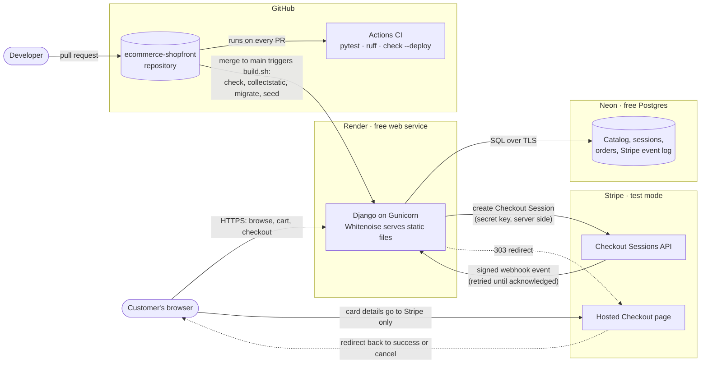
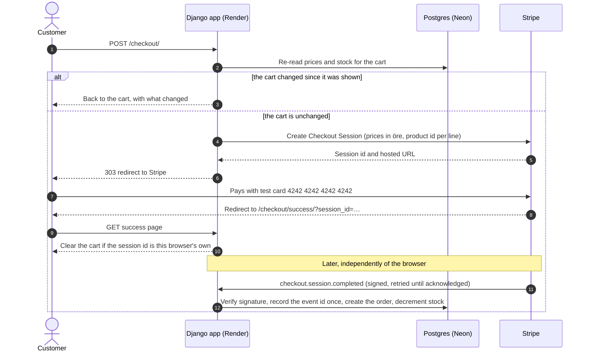

# shopfront

A small Django store with Stripe test-mode checkout and an admin panel.

**Live demo: [shopfront-da2o.onrender.com](https://shopfront-da2o.onrender.com)**. It runs on a
free instance that sleeps when idle, so the first visit can take about a minute to wake it.

**Status:** Milestone 5. Paying creates an order through a signed, idempotent Stripe
webhook that cannot double-process a replayed event or oversell the last unit, and staff
work orders through a guarded admin. Demo polish is next.

## Why this exists

Most portfolio stores stop at a product grid and a fake checkout. This one is built
around the part real payment systems get wrong: **webhook handling that stays correct
when Stripe delivers the same event twice.** See [Milestones](#milestones).

Payments run in **Stripe test mode only**. The app never handles card details — checkout
happens on Stripe's hosted page.

## How it fits together



Secrets (`DJANGO_SECRET_KEY`, `DATABASE_URL`, `STRIPE_SECRET_KEY`,
`STRIPE_WEBHOOK_SECRET`) live only in Render's environment and a local, gitignored `.env`.
Dashed lines are browser redirects.

### A purchase, step by step



The success redirect is not trusted as proof of payment: a customer can close the tab
before it happens, and anyone can type the URL. Orders come only from the signed webhook.

## How an order is created exactly once

Stripe delivers webhooks *at least* once: it retries until it gets a 2xx, and the same
payment can be described by more than one event. The handler
([`core/fulfilment.py`](core/fulfilment.py)) makes three guarantees, each pinned by tests:

1. **A replayed event changes nothing.** The Stripe `event.id` goes into a column with a
   unique constraint, in the same transaction as the order. A second delivery fails that
   insert and is acknowledged with a 200. The order itself is also unique on the Checkout
   Session id, so two *different* events for one payment still make one order.
2. **Nothing is half-done.** Recording the event, creating the order and decrementing
   stock commit together or not at all. If anything fails, the endpoint answers 500,
   Stripe retries, and the retry starts from a clean slate. If the event were recorded
   first, a crash before the order would make the retry look like a duplicate, and the
   order would be lost.
3. **Stock never goes negative.** Stock isn't reserved during checkout, so two customers
   can pay for the last unit. Product rows are locked with `SELECT ... FOR UPDATE`, in
   primary-key order so concurrent orders cannot deadlock, before stock is checked. A paid
   order that can't be filled is kept and flagged **needs refund**, never partly filled.

Other details: the signature is verified against the raw body, with Stripe's 5-minute
timestamp tolerance against captured-request replays. The Checkout Session is re-fetched
from Stripe *outside* the transaction, so no row lock is held across a network call.
Sessions the shop didn't create (no `product_id` on their lines) are logged and ignored
rather than crashing and being retried for days. Order lines copy the product name and
price, so later catalog edits never rewrite what a customer paid.

The races are tested for real: CI runs the suite a second time against Postgres, where two
threads behind a barrier pay for the last unit at the same moment, and deliver the same
event at the same moment. SQLite serialises all writes, so those tests skip there. It was
also checked end to end: a sandbox payment through the Stripe CLI created one order, and
`stripe events resend` of the same event was acknowledged without a second order or a
second stock decrement.

## Running it locally

```bash
python3 -m venv .venv && source .venv/bin/activate
pip install -r requirements-dev.txt
cp .env.example .env          # add an sk_test_ key to try checkout
python manage.py migrate
python manage.py seed          # twelve demo products across three categories
python manage.py runserver
```

The app uses SQLite locally and Postgres wherever `DATABASE_URL` is set.

To receive webhooks locally, forward them with the [Stripe CLI](https://docs.stripe.com/stripe-cli),
and start the server with the signing secret it prints:

```bash
stripe listen --forward-to localhost:8000/stripe/webhook/ --events checkout.session.completed
STRIPE_WEBHOOK_SECRET="$(stripe listen --print-secret)" python manage.py runserver
```

### Tests and linting

```bash
pytest
ruff check .
ruff format --check .
```

All three run in CI on every pull request, along with Django's `check --deploy`. CI runs
the tests twice, on SQLite and on Postgres; the concurrency tests need Postgres row locks
and skip on SQLite.

## Milestones

| # | Scope | Status |
|---|---|---|
| 0 | Skeleton, CI, deployment, health check | ✅ |
| 1 | Catalog: products, categories, admin, seed data | ✅ |
| 2 | Session cart: add, update, remove, server-side totals | ✅ |
| 3 | Stripe Checkout session | ✅ |
| 4 | Webhook: signature verification, idempotent fulfilment, stock decrement | ✅ |
| 5 | Admin: order management, shipping actions, event audit | ✅ |
| 6 | Demo polish: screenshots, seeded data, test-card instructions | |

## Design decisions

**Money is stored as integer minor units** (öre), never floats. `0.1 + 0.2 != 0.3` in
binary floating point, and a rounding error per line item compounds across a cart. Totals
are summed in minor units and converted to a decimal once, for display only.

**Product images are static files, not uploads.** Free hosting has an ephemeral
filesystem — anything uploaded disappears on the next redeploy. The `Product.image` field
holds a path under `static/`, so images survive deploys and cost nothing to serve. Real
uploads would need object storage, which would mean a paid account.

**The session stores product ids and quantities, nothing else.** Prices are read from
the database every time the cart is rendered, so an admin price change reaches carts that
already hold the product, and a cart can never pay a stale price. With Django's database
sessions the browser only holds an opaque key, but the rule doesn't depend on that: if
the session engine were switched to signed cookies, a price stored there would be readable
client data and one step from a forged discount.

**Deploys never overwrite catalog data.** `build.sh` runs `seed` on every deploy, and
`seed` only acts on an empty catalog. Once orders decrement stock and prices are edited in
the admin, a deploy that reset them would let the shop sell units it no longer has. There
are regression tests for it. For the same reason, a deploy without `DJANGO_SECRET_KEY`
fails `check --deploy` rather than falling back to the public development key.

**The cart reconciles against the catalog before it is shown.** A cart can sit in a
session for weeks, during which a product can be withdrawn, deleted or sold out. Rather
than failing at checkout, the cart clamps quantities to available stock, drops what can no
longer be sold, and says what it changed.

**Browsing creates no session.** The cart deliberately does not touch the session until
something is added. An earlier version called `session.setdefault` on construction, which
marked the session dirty on every request and wrote a session row for every visitor,
crawlers included. There's a regression test for it.

**Checkout is Stripe's hosted page, reached by a server-side redirect.** Card details
never touch this app, which keeps it out of PCI scope, and no Stripe JavaScript is
loaded. Line items are built from catalog prices in öre (the unit Stripe expects), and
each carries its product id for the webhook. The cart is reconciled first: if stock moved,
the customer reviews the corrected cart instead of paying for a surprise.

**The success page is not proof of payment.** A customer can pay and close the tab before
the redirect, and anyone can type the success URL. So the success page only clears the
cart, and only for the Checkout Session that browser started. Creating orders is the
webhook's job, because Stripe retries it until it lands.

**The look costs nothing at runtime.** No web fonts: headings use a serif stack (Iowan
Old Style, Charter, Palatino) already installed on macOS, iOS and Windows. The product
illustrations are hand-written SVGs of a few kilobytes each. Motion is CSS only: cards rise
in and lift on hover, messages slide in, and same-site navigations crossfade through the
browser's View Transitions, with each product image morphing from the grid into its own
page. Browsers without View Transitions navigate normally. Under `prefers-reduced-motion`
every animation is switched off, though no state change depends on one.

**Plain forms, not HTMX.** The cart works with JavaScript disabled and depends on no
third-party script at runtime. HTMX can be layered on later as enhancement; starting with
it would have meant a CDN dependency for a demo that doesn't need one.

**Staff can't edit an order, only move it forward.** Orders come from the webhook alone,
so the admin shows them read-only, with their line items and the Stripe events behind
them. Two actions change status: *mark as shipped* (paid → shipped) and *mark as refunded*
(needs refund → refunded, after refunding in Stripe). Each is a single conditional
`UPDATE ... WHERE status = ...`, so two staff acting at once can't ship an order twice, and
a mis-click can't ship one that is waiting for a refund; anything in the wrong state is
skipped and counted. The actions need the change-order permission, so view-only staff can
look but not act.

**Stock is adjusted, never overwritten.** The admin used to edit stock as an absolute
number: open a product at 5, let an order take 2, save the form, and stock went back to 5,
undoing the sale. Stock on an existing product is now read-only. Staff enter an adjustment
(+10 for a delivery, -1 for a breakage), applied as `stock = stock + n` against whatever
the row holds at save time and refused if it would go below zero. The rest of the form
saves only the fields that changed, so it never writes stale stock back either. There are
regression tests for both.

**Withdrawn products return 404, not 403.** A 403 confirms the product exists; a 404
doesn't leak that an item was ever listed.

**The category nav comes from a context processor.** It was built per-view at first and
promptly went missing from the product detail page. There's a regression test for it now.

## Known limitations

- **Cold starts.** The free Render instance sleeps after about 15 minutes idle, and the
  Neon database after 5, so the first request after a quiet spell takes about a minute.
- **Free-tier ceilings.** Render allows 750 instance hours a month and Neon 100 compute
  hours. A demo stays far below both, but sustained bot traffic could pause the database
  until the next month. Nothing is billed: no card is on file.
- **Stock is not reserved while it sits in a cart.** Two customers can both hold the last
  unit. The cart re-checks stock when shown, and checkout (milestone 3) will be the point
  where it is enforced.
- **New demo products don't reach an existing database.** Because `seed` only fills an
  empty catalog, products added to the seed list later have to be created in the admin.
- **Images ship with the code.** Adding a product image means a commit and a deploy, the
  trade-off for not paying for object storage.
- **Refunds are manual.** An order flagged *needs refund* (paid for stock that sold out
  meanwhile) is refunded in the Stripe dashboard, then marked refunded in the admin.
  Issuing the refund through the API is out of scope.
- **Only immediate payment methods.** The webhook fulfils `checkout.session.completed`
  when the session is already paid (cards, wallets). Delayed methods that confirm later
  via `checkout.session.async_payment_succeeded` aren't handled.

## Deliberately out of scope

User accounts, reviews, wishlists, coupons, search, multi-currency, shipping
calculations, and email receipts (Stripe sends those). Guest checkout only.

## Stack

Django 5 · PostgreSQL (Neon) · Stripe Checkout · Whitenoise · Gunicorn · pytest · ruff

## Licence

MIT — see [LICENSE](LICENSE).
